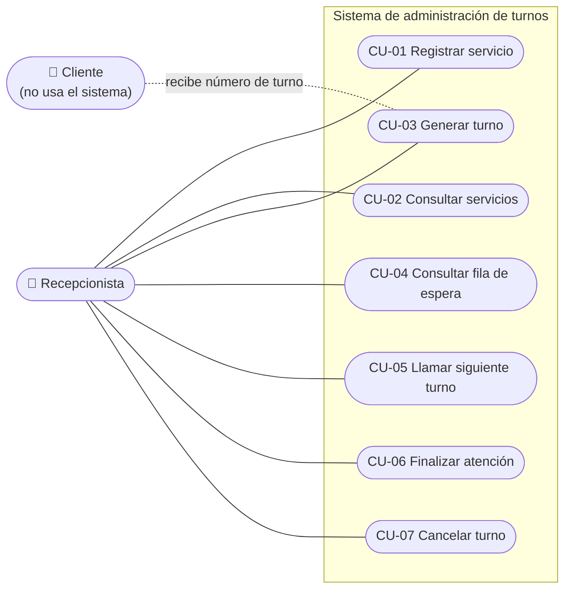

# Casos de uso / Use cases

> Estado / Status: Borrador para revisión del equipo / Draft for team review

---

## 🇪🇸 Español

### Diagrama de casos de uso

### Resumen

| ID | Caso de uso | Actor | Req. | Spec |
|----|-------------|-------|------|------|
| CU-01 | Registrar servicio | Recepcionista | RF01 | SPEC-01 |
| CU-02 | Consultar servicios | Recepcionista | RF01 | SPEC-01 |
| CU-03 | Generar turno | Recepcionista | RF02 | SPEC-02 |
| CU-04 | Consultar fila de espera | Recepcionista | RF03 | SPEC-03 |
| CU-05 | Llamar siguiente turno | Recepcionista | RF04 | SPEC-04 |
| CU-06 | Finalizar atención | Recepcionista | RF05 | SPEC-05 |
| CU-07 | Cancelar turno | Recepcionista | RF06 | SPEC-06 |

### CU-01 Registrar servicio
- **Actor:** Recepcionista · **Precondición:** ninguna.
- **Flujo principal:** 1) Ingresa nombre y prefijo. 2) El sistema valida (RN-01, RN-02). 3) El sistema guarda el servicio. 4) Confirma el registro.
- **Flujos alternos:** 2a) Nombre o prefijo vacío → mensaje de error, no se guarda. 2b) Nombre o prefijo repetido → mensaje de error, no se guarda.
- **Postcondición:** el servicio existe y puede recibir turnos.

### CU-02 Consultar servicios
- **Flujo principal:** 1) Solicita la lista. 2) El sistema muestra nombre y prefijo de cada servicio.
- **Alterno:** 2a) No hay servicios → mensaje que invita a registrar uno.

### CU-03 Generar turno
- **Precondición:** el servicio existe.
- **Flujo principal:** 1) Selecciona un servicio. 2) El sistema calcula el siguiente correlativo del día (RN-04). 3) Crea el turno En espera (RN-05). 4) Muestra el número (ej. `A-001`) para entregarlo al cliente.
- **Alterno:** 1a) Servicio inexistente → error (RN-03).
- **Postcondición:** turno En espera al final de la fila.

### CU-04 Consultar fila de espera
- **Precondición:** el servicio existe.
- **Flujo principal:** 1) Selecciona un servicio. 2) El sistema muestra los turnos En espera en orden de llegada (RN-06) y su cantidad.
- **Alterno:** 2a) Fila vacía → mensaje "No hay turnos en espera".

### CU-05 Llamar siguiente turno
- **Precondición:** el servicio existe.
- **Flujo principal:** 1) Selecciona un servicio y pide el siguiente. 2) El sistema toma el turno En espera más antiguo (RN-07). 3) Lo pasa a En atención. 4) Muestra el número llamado.
- **Alterno:** 2a) No hay turnos en espera → informa fila vacía (RN-08).
- **Postcondición:** el turno llamado queda En atención.

### CU-06 Finalizar atención
- **Precondición:** existe un turno En atención.
- **Flujo principal:** 1) Selecciona el turno En atención. 2) El sistema lo pasa a Finalizado (RN-09). 3) Confirma el cierre.
- **Alterno:** 2a) El turno no está En atención → error y sin cambios.

### CU-07 Cancelar turno
- **Precondición:** existe un turno En espera.
- **Flujo principal:** 1) Selecciona el turno. 2) El sistema pide confirmación. 3) El recepcionista confirma. 4) El turno pasa a Cancelado (RN-10).
- **Alternos:** 3a) No confirma → no hay cambios. 2b) El turno no está En espera → error y sin cambios.

---

## 🇬🇧 English

### Summary

| ID | Use case | Actor | Req. | Spec |
|----|----------|-------|------|------|
| CU-01 | Register service | Receptionist | RF01 | SPEC-01 |
| CU-02 | List services | Receptionist | RF01 | SPEC-01 |
| CU-03 | Generate ticket | Receptionist | RF02 | SPEC-02 |
| CU-04 | View waiting queue | Receptionist | RF03 | SPEC-03 |
| CU-05 | Call next ticket | Receptionist | RF04 | SPEC-04 |
| CU-06 | Finish service | Receptionist | RF05 | SPEC-05 |
| CU-07 | Cancel ticket | Receptionist | RF06 | SPEC-06 |

The use case diagram above applies to both languages.

### CU-01 Register service
- **Actor:** Receptionist · **Precondition:** none.
- **Main flow:** 1) Enters name and prefix. 2) System validates (RN-01, RN-02). 3) System saves the service. 4) Confirms registration.
- **Alternate flows:** 2a) Empty name or prefix → error message, nothing saved. 2b) Duplicate name or prefix → error message, nothing saved.
- **Postcondition:** the service exists and can receive tickets.

### CU-02 List services
- **Main flow:** 1) Requests the list. 2) System shows each service's name and prefix.
- **Alternate:** 2a) No services → message inviting to register one.

### CU-03 Generate ticket
- **Precondition:** the service exists.
- **Main flow:** 1) Selects a service. 2) System computes the day's next sequence (RN-04). 3) Creates the Waiting ticket (RN-05). 4) Shows the number (e.g. `A-001`) to hand to the customer.
- **Alternate:** 1a) Non-existent service → error (RN-03).
- **Postcondition:** Waiting ticket at the end of the queue.

### CU-04 View waiting queue
- **Precondition:** the service exists.
- **Main flow:** 1) Selects a service. 2) System shows Waiting tickets in arrival order (RN-06) and their count.
- **Alternate:** 2a) Empty queue → "No tickets waiting" message.

### CU-05 Call next ticket
- **Precondition:** the service exists.
- **Main flow:** 1) Selects a service and requests the next one. 2) System takes the oldest Waiting ticket (RN-07). 3) Moves it to In service. 4) Shows the called number.
- **Alternate:** 2a) No waiting tickets → reports empty queue (RN-08).
- **Postcondition:** the called ticket is In service.

### CU-06 Finish service
- **Precondition:** an In-service ticket exists.
- **Main flow:** 1) Selects the In-service ticket. 2) System moves it to Finished (RN-09). 3) Confirms closure.
- **Alternate:** 2a) Ticket is not In service → error, no changes.

### CU-07 Cancel ticket
- **Precondition:** a Waiting ticket exists.
- **Main flow:** 1) Selects the ticket. 2) System asks for confirmation. 3) Receptionist confirms. 4) Ticket becomes Cancelled (RN-10).
- **Alternates:** 3a) Does not confirm → no changes. 2b) Ticket is not Waiting → error, no changes.
