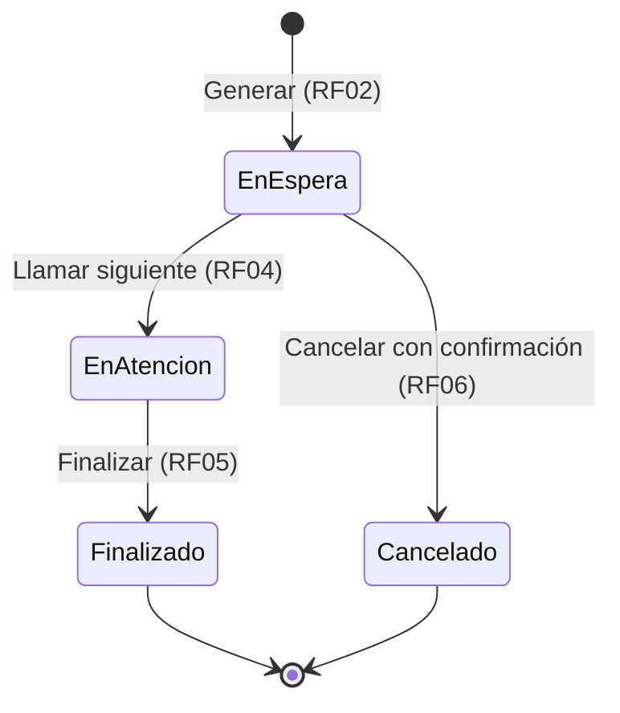

# Requerimientos / Requirements

> Fuente / Source: Plan de trabajo, sección 4 · Constitución v1.0.0
> Estado / Status: Borrador para revisión del equipo / Draft for team review

---

## 🇪🇸 Español

### Requerimientos funcionales

RF01 a RF05 forman el **flujo mínimo viable** y se implementan primero. RF06 se hace según el tiempo disponible.

| ID | Requerimiento | Spec | Prioridad | Actor |
|----|---------------|------|-----------|-------|
| RF01 | Registrar y consultar servicios (nombre y prefijo) | SPEC-01 | Alta | ACT-01 |
| RF02 | Generar turno con número correlativo del día | SPEC-02 | Alta | ACT-01 |
| RF03 | Consultar la fila de espera de un servicio | SPEC-03 | Alta | ACT-01 |
| RF04 | Llamar al siguiente turno | SPEC-04 | Alta | ACT-01 |
| RF05 | Finalizar la atención de un turno | SPEC-05 | Alta | ACT-01 |
| RF06 | Cancelar un turno en espera, con confirmación | SPEC-06 | Secundaria | ACT-01 |

### Reglas de negocio de referencia

> Son una propuesta de análisis. La redacción definitiva y sus criterios Dado/Cuando/Entonces se aprueban en cada especificación (`specs/`).

| ID | Regla | Req. |
|----|-------|------|
| RN-01 | Un servicio tiene nombre y prefijo; el prefijo identifica al servicio en el número de turno. | RF01 |
| RN-02 | El nombre y el prefijo de un servicio no pueden estar vacíos ni repetirse entre servicios. | RF01 |
| RN-03 | Un turno solo puede generarse para un servicio existente. | RF02 |
| RN-04 | El número de turno es `prefijo + correlativo` (ej. `A-001`). El correlativo es por servicio y **se reinicia cada día**. | RF02 |
| RN-05 | Todo turno nuevo nace en estado **En espera**. | RF02 |
| RN-06 | La fila de espera de un servicio muestra solo turnos *En espera* del día, en orden de llegada (el más antiguo primero). | RF03 |
| RN-07 | Llamar al siguiente toma el turno En espera más antiguo del servicio y lo pasa a **En atención**. | RF04 |
| RN-08 | Si no hay turnos en espera, llamar al siguiente informa que la fila está vacía y no cambia nada. | RF04 |
| RN-09 | Solo un turno En atención puede finalizarse; pasa a **Finalizado**. | RF05 |
| RN-10 | Solo un turno En espera puede cancelarse; pasa a **Cancelado** y requiere confirmación explícita. | RF06 |
| RN-11 | Un turno Finalizado o Cancelado no cambia de estado nunca más. | RF05, RF06 |

### Estados y transiciones del turno

### Requerimientos no funcionales (derivados de la constitución)

| ID | Requerimiento | Principio |
|----|---------------|-----------|
| RNF-01 | Arquitectura en capas Domain, Application, Infrastructure y Web; Domain no depende de ninguna otra capa; las reglas de negocio no viven en Web ni en la base de datos. | IV |
| RNF-02 | Mensajes claros de confirmación y error; etiquetas accesibles, contraste legible y navegación por teclado. | VII |
| RNF-03 | Cada criterio de aceptación tiene al menos una prueba con evidencia. | VI |
| RNF-04 | Documentación y especificaciones en español e inglés con el mismo significado. | IX |
| RNF-05 | Solución en C#/.NET (versión a acordar por el equipo). | IV |

### Supuestos por confirmar en las specs
1. Formato del prefijo (propuesta: 1 a 3 letras mayúsculas) y del correlativo (3 dígitos con ceros).
2. Si puede haber más de un turno *En atención* a la vez por servicio (propuesta: uno solo; hay que finalizarlo antes de llamar al siguiente).
3. Qué muestra la fila de espera al cambiar de día.

---

## 🇬🇧 English

### Functional requirements

RF01 to RF05 form the **minimum viable flow** and are implemented first. RF06 is done as time allows.

| ID | Requirement | Spec | Priority | Actor |
|----|-------------|------|----------|-------|
| RF01 | Register and list services (name and prefix) | SPEC-01 | High | ACT-01 |
| RF02 | Generate a ticket with a daily sequential number | SPEC-02 | High | ACT-01 |
| RF03 | View a service's waiting queue | SPEC-03 | High | ACT-01 |
| RF04 | Call the next ticket | SPEC-04 | High | ACT-01 |
| RF05 | Finish the service of a ticket | SPEC-05 | High | ACT-01 |
| RF06 | Cancel a waiting ticket, with confirmation | SPEC-06 | Secondary | ACT-01 |

### Reference business rules

> These are an analysis proposal. Final wording and Given/When/Then criteria are approved in each specification (`specs/`).

| ID | Rule | Req. |
|----|------|------|
| RN-01 | A service has a name and a prefix; the prefix identifies the service in the ticket number. | RF01 |
| RN-02 | A service's name and prefix cannot be empty or repeated across services. | RF01 |
| RN-03 | A ticket can only be generated for an existing service. | RF02 |
| RN-04 | Ticket number is `prefix + sequence` (e.g. `A-001`). The sequence is per service and **resets every day**. | RF02 |
| RN-05 | Every new ticket starts as **Waiting**. | RF02 |
| RN-06 | A service's queue shows only today's *Waiting* tickets, in arrival order (oldest first). | RF03 |
| RN-07 | Calling next takes the service's oldest Waiting ticket and moves it to **In service**. | RF04 |
| RN-08 | If there are no waiting tickets, calling next reports the queue is empty and changes nothing. | RF04 |
| RN-09 | Only an In-service ticket can be finished; it becomes **Finished**. | RF05 |
| RN-10 | Only a Waiting ticket can be cancelled; it becomes **Cancelled** and requires explicit confirmation. | RF06 |
| RN-11 | A Finished or Cancelled ticket never changes state again. | RF05, RF06 |

### Ticket states and transitions

See the state diagram in the Spanish section (states: Waiting → In service → Finished; Waiting → Cancelled).

### Non-functional requirements (derived from the constitution)

| ID | Requirement | Principle |
|----|-------------|-----------|
| RNF-01 | Layered architecture Domain, Application, Infrastructure and Web; Domain depends on no other layer; business rules live neither in Web nor in the database. | IV |
| RNF-02 | Clear confirmation and error messages; accessible labels, readable contrast and keyboard navigation. | VII |
| RNF-03 | Every acceptance criterion has at least one test with evidence. | VI |
| RNF-04 | Documentation and specifications in Spanish and English with the same meaning. | IX |
| RNF-05 | Solution in C#/.NET (version to be agreed by the team). | IV |

### Assumptions to confirm in the specs
1. Prefix format (proposal: 1 to 3 uppercase letters) and sequence format (3 digits, zero-padded).
2. Whether more than one *In service* ticket per service is allowed (proposal: only one; it must be finished before calling the next).
3. What the queue shows when the day changes.
