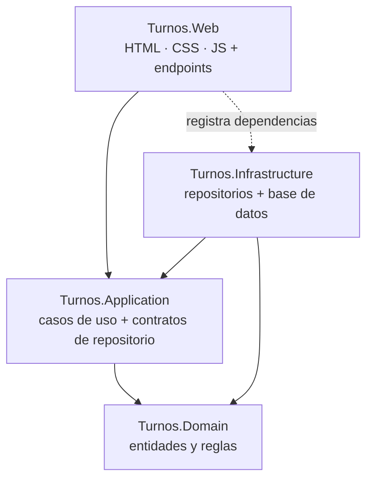

# Arquitectura y justificación / Architecture and rationale

> Estado / Status: Borrador para revisión del equipo / Draft for team review

---

## 🇪🇸 Español

### Estilo elegido: arquitectura en capas (Domain → Application → Infrastructure / Web)

### Reglas de dependencia

| Capa | Puede referenciar | No puede referenciar |
|------|-------------------|----------------------|
| Domain | nada | Application, Infrastructure, Web |
| Application | Domain | Infrastructure, Web |
| Infrastructure | Application, Domain | Web |
| Web | Application (y Infrastructure solo para registrar dependencias) | acceso directo a datos |
| Tests | Domain, Application | — |

### Justificación

1. **Lo exige la constitución (principio IV).** Domain no depende de ninguna capa y las reglas de negocio no van en Web ni en la base de datos.
2. **Reglas probables y aisladas.** Las transiciones del turno (RN-05 a RN-11) viven en Domain y se prueban sin base de datos ni interfaz, lo que facilita una prueba por criterio de aceptación (principio VI).
3. **Trabajo en paralelo.** Cada integrante trabaja en su carpeta: backend en `Domain`/`Application`, frontend en `Web`, sin pisarse (plan de trabajo, regla 2).
4. **Persistencia reemplazable.** Application depende de interfaces de repositorio, así que el motor de base de datos puede cambiar o simularse en pruebas sin tocar las reglas.
5. **Tamaño acorde al alcance.** Cuatro proyectos son suficientes para el flujo mínimo viable (principio V); alternativas como microservicios o CQRS añadirían complejidad sin necesidad.

### Alternativas descartadas

| Alternativa | Motivo de descarte |
|-------------|--------------------|
| Todo en un solo proyecto Web | Mezcla reglas con presentación y datos; contradice el principio IV. |
| Microservicios | Excesivo para un solo actor y seis requerimientos. |
| Lógica en procedimientos almacenados | Las reglas quedarían en la base de datos (principio IV). |

### Decisiones pendientes (para el equipo)
- Versión de .NET (a acordar antes de crear la solución).
- Motor de base de datos para el script de `database/`.
- Estilo de la capa Web: API mínima + archivos estáticos o MVC (la interfaz es HTML/CSS/JS).

---

## 🇬🇧 English

### Chosen style: layered architecture (Domain → Application → Infrastructure / Web)

See the diagram in the Spanish section.

### Dependency rules

| Layer | May reference | May not reference |
|-------|---------------|-------------------|
| Domain | nothing | Application, Infrastructure, Web |
| Application | Domain | Infrastructure, Web |
| Infrastructure | Application, Domain | Web |
| Web | Application (and Infrastructure only to register dependencies) | direct data access |
| Tests | Domain, Application | — |

### Rationale

1. **Required by the constitution (principle IV).** Domain depends on no layer and business rules live neither in Web nor in the database.
2. **Testable, isolated rules.** Ticket transitions (RN-05 to RN-11) live in Domain and are tested without a database or UI, making one test per acceptance criterion easy (principle VI).
3. **Parallel work.** Each member works in their own folder: backend in `Domain`/`Application`, frontend in `Web`, without stepping on each other (work plan, rule 2).
4. **Replaceable persistence.** Application depends on repository interfaces, so the database engine can change or be faked in tests without touching the rules.
5. **Size matches the scope.** Four projects are enough for the minimum viable flow (principle V); alternatives such as microservices or CQRS would add complexity without need.

### Discarded alternatives

| Alternative | Reason |
|-------------|--------|
| Everything in a single Web project | Mixes rules with presentation and data; contradicts principle IV. |
| Microservices | Excessive for one actor and six requirements. |
| Logic in stored procedures | Rules would end up in the database (principle IV). |

### Pending decisions (for the team)
- .NET version (agree before creating the solution).
- Database engine for the `database/` script.
- Web layer style: minimal API + static files or MVC (the UI is HTML/CSS/JS).
