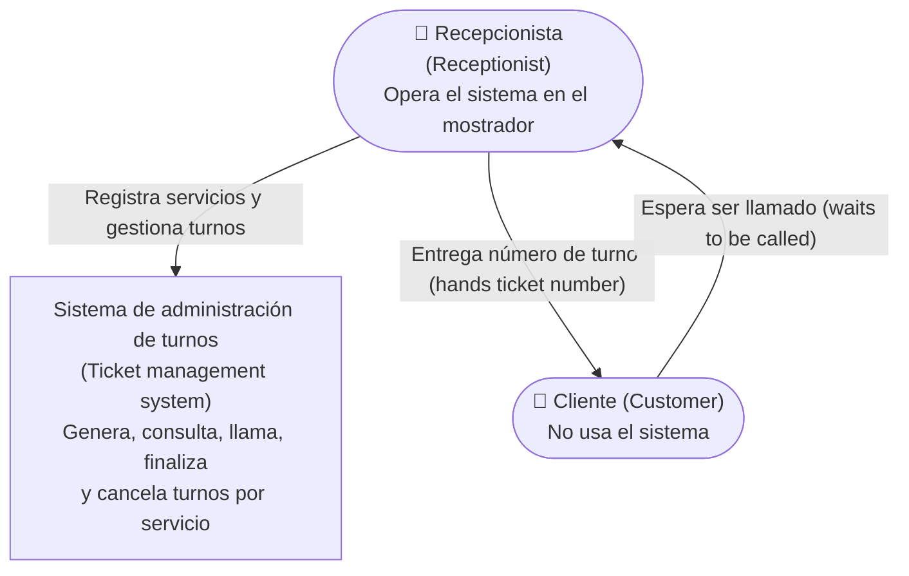
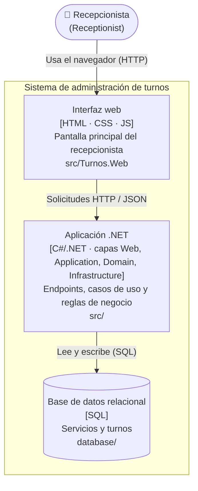
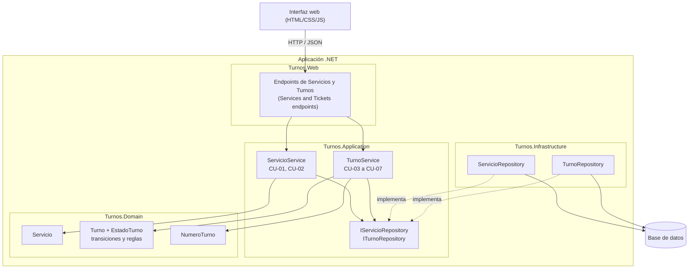

# Diagramas C4 / C4 diagrams (C1, C2, C3)

> Los diagramas son comunes a ambos idiomas; las etiquetas están en español, con inglés entre paréntesis.
> Diagrams are shared by both languages; labels are in Spanish with English in parentheses.
> Se renderizan en GitHub (Mermaid) / Rendered by GitHub (Mermaid).

---

## C1 · Contexto del sistema / System context

**ES:** el recepcionista es el único usuario del sistema. El cliente interactúa solo con el recepcionista y no accede al sistema. No hay sistemas externos en el alcance mínimo viable.
**EN:** the receptionist is the only user. The customer interacts only with the receptionist and never accesses the system. There are no external systems in the minimum viable scope.

---

## C2 · Contenedores / Containers

| Contenedor / Container | Tecnología / Technology | Responsabilidad / Responsibility |
|---|---|---|
| Interfaz web / Web UI | HTML, CSS, JS | Mostrar servicios, fila y acciones; pedir confirmación al cancelar; mostrar mensajes de éxito y error. / Show services, queue and actions; ask confirmation on cancel; show success and error messages. |
| Aplicación .NET / .NET application | C#/.NET | Exponer endpoints, ejecutar casos de uso y aplicar las reglas de negocio. / Expose endpoints, run use cases and apply business rules. |
| Base de datos / Database | SQL (motor por definir / engine TBD) | Persistir servicios y turnos. / Persist services and tickets. |

---

## C3 · Componentes de la aplicación .NET / Components of the .NET application

| Componente / Component | Capa / Layer | Casos de uso / Use cases | Req. |
|---|---|---|---|
| Endpoints | Web | Todos / All | RF01 a RF06 |
| `ServicioService` | Application | CU-01, CU-02 | RF01 |
| `TurnoService` | Application | CU-03 a CU-07 | RF02 a RF06 |
| `Servicio`, `Turno`, `EstadoTurno`, `NumeroTurno` | Domain | Reglas RN-01 a RN-11 | RF01 a RF06 |
| `ServicioRepository`, `TurnoRepository` | Infrastructure | Persistencia / Persistence | RF01 a RF06 |

Detalle de responsabilidades en [componentes.md](componentes.md); justificación en [arquitectura.md](arquitectura.md).
