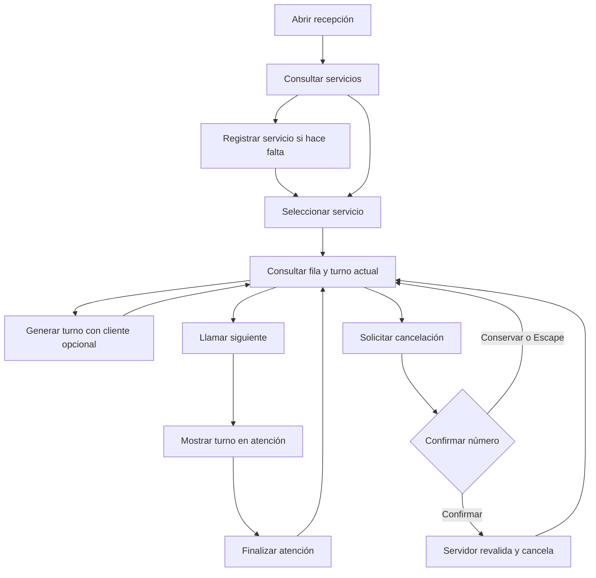

# Wireframes y flujo / Wireframes and flow

## Español

Alcance del integrante 4: interfaz del recepcionista para SPEC-01 a SPEC-06. No incluye pantalla pública, autenticación, reportes ni impresión. Base revisada: `08b06a0` de main. Las especificaciones ya están en main aunque sus encabezados conservan Borrador/Draft; esta entrega no cambia su estado ni presume una aprobación humana nueva.

### Pantalla principal: escritorio

```text
┌────────────────────────────────────────────────────────────┐
│ Turnos · Administración de atención               Recepción│
├────────────────────────────────────────────────────────────┤
│ Panel de recepción                       Fecha local       │
│ Mensaje de confirmación o error                            │
├───────────────────┬────────────────────────────────────────┤
│ Servicios         │ Servicio [Selecciona ▼] [Actualizar fila]│
│ Nombre [        ] ├──────────────────┬─────────────────────┤
│ Prefijo [       ] │ Nuevo turno      │ Turno actual        │
│ [Registrar]       │ Cliente opcional │ Número / Ninguno    │
│                   │ [Generar turno]  │ [Llamar siguiente]  │
│ Lista de servicios│ Número emitido   │ [Finalizar atención]│
│ Nombre · Prefijo  ├──────────────────┴─────────────────────┤
│                   │ Fila de espera              N en espera│
│                   │ Posición | Número | Cliente | Cancelar │
└───────────────────┴────────────────────────────────────────┘
```

En móvil, las secciones se apilan en el mismo orden: servicios, selección, generación, atención y fila. La tabla permite desplazamiento horizontal si el contenido lo necesita. Confirmación modal de cancelación: número identificado, explicación, Conservar turno como foco inicial y Confirmar cancelación. Escape conserva el turno.

### Flujo



Estados de presentación: sin servicios; sin selección; consultando; fila vacía; fila con turnos; turno actual o Ninguno; confirmación; éxito; error y reintento. Una acción pendiente bloquea controles para evitar envíos repetidos. Cambiar servicio elimina la fila anterior y el último número generado. Un error de consulta elimina datos obsoletos. Las reglas de orden, fecha, transición y correlativo se delegan al servidor.

Accesibilidad: etiquetas asociadas, HTML semántico, estado anunciado con aria-live, foco visible, botones operables por teclado, diálogo nativo y enlace para saltar al contenido. No se usan colores como único indicador del estado. Se verificaron etiquetas, teclado y diseño móvil; no se afirma una certificación completa de accesibilidad.

## English

Member 4 delivers the receptionist UI for SPEC-01 through SPEC-06. Public displays, authentication, reports and printing are excluded. Reviewed baseline: main `08b06a0`. Specs are merged but their headers still say Draft; this delivery does not change approval status.

The desktop wireframe above places service registration on the left, service selection at the top, generation/current attention side by side, and the waiting queue below. Mobile stacks these sections in the same order. The cancellation dialog identifies the ticket, initially focuses Keep ticket, and supports Escape without changing data.

The flow above covers service registration/selection, queue/current retrieval, ticket generation, calling, completion, and confirmed cancellation. Presentation states include loading, empty services, missing selection, empty queue, active ticket, success, confirmation and recoverable errors. Pending actions lock controls; changing service clears stale information. Ordering, local-day filtering, transitions, persistence and numbering belong to the server.

Semantic HTML, associated labels, live announcements, visible focus, native dialogs, keyboard controls and a skip link support accessibility. Labels, keyboard operation and mobile layout were checked; this is not a full accessibility certification.
